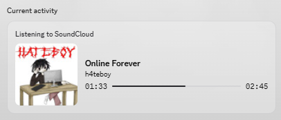

<!-- [TODO: add build status badge: no CI workflow or repository URL found in the source archive] -->

**English** | [Русский](README.ru.md)



# rpc4SoundCloud Enhanced

Discord Rich Presence for SoundCloud. The project reads the current track from a browser tab on soundcloud.com and publishes it as a "Listening to SoundCloud" activity in the Discord desktop client through a Vencord plugin.

This is a fork of [rpc4SoundCloud](https://github.com/loren-wastaken/rpc4SoundCloud) by loren-wastaken. The playback state handling was rewritten; see [Improvements over the original](#improvements-over-the-original).

## Contents

- [Improvements over the original](#improvements-over-the-original)
- [Architecture](#architecture)
- [Requirements](#requirements)
- [Installation](#installation)
- [Configuration](#configuration)
- [Verification](#verification)
- [Behavior reference](#behavior-reference)
- [Known issues](#known-issues)
- [Project layout](#project-layout)
- [License](#license)
- [Disclaimer](#disclaimer)

## Improvements over the original

| Area | Original behavior | rpc4SoundCloud Enhanced |
|---|---|---|
| Timer on pause | Elapsed timer kept running while the track was paused | Presence is cleared on pause. On resume, the timer is recalculated from the current playback position |
| Progress bar | Not shown; only the elapsed time was sent (`timestamps.start`) | Track duration is read from the player (`durationSeconds`) and sent as `timestamps.end`, which renders a progress bar |
| Buffering | Buffering was not handled | Buffering is detected (position equal to 0, or unchanged across consecutive polls). The presence is hidden until playback continues |
| Page reload | Stale presence could persist after the SoundCloud page was reloaded | Presence is cleared when the extension connects to the relay and on every URL change |
| Single tracks | Title was shown twice on all tracks due to the `large_text` field (artwork tooltip), which Discord duplicated into the second line | The `large_text` field is removed to prevent duplication. The artist line is omitted if it matches the title (case-insensitive comparison) |
| Distribution | Manual loading only | Published on Firefox Add-ons |

## Architecture

The system consists of three components connected through a local WebSocket relay.

| Component | Directory | Runs in | Responsibility |
|---|---|---|---|
| Browser extension | `extension/` | Browser, on `soundcloud.com` tabs | Polls `navigator.mediaSession` and the player timeline once per second. Sends a JSON payload to the relay when it changes |
| Relay server | `relay-server/` | Node.js process on the local machine | WebSocket server. Forwards every received message to all other connected clients |
| Vencord plugin | `vencord-plugin/` | Discord desktop client with Vencord | Connects to the relay, converts payloads into an activity, and dispatches `LOCAL_ACTIVITY_UPDATE` |

Data flow:

```text
SoundCloud tab -> extension (WS client) -> relay server (WS server) -> Vencord plugin (WS client) -> Discord
```

The relay is required because neither a browser tab nor the Discord renderer process can accept incoming connections.

## Requirements

| Dependency | Used by | Notes |
|---|---|---|
| Node.js and npm | Relay server | Required version is not specified in the source |
| `ws` `^8.18.0` | Relay server | Installed by `npm install` |
| Vencord source checkout | Vencord plugin | The plugin is built into Vencord from source (`src/userplugins/`) |
| pnpm | Vencord build | `linux.sh` installs it through npm if missing |
| git | Vencord checkout | Required by `linux.sh` |
| Discord desktop client | Presence display | Vencord must be injected into the client |
| Firefox, Chrome, Edge or Opera | Extension | See [Browser extension](#2-browser-extension) |

## Installation

All three components must be installed. The relay server and the Vencord plugin are not distributed through any browser store.

### 1. Relay server

```bash
cd relay-server
npm install
npm start
```

The process must stay running while presence is in use. The server listens on port `6989`.

#### Auto-start on Windows

1. Run `npm install` in `relay-server/` at least once.
2. Press `Win + R`, enter `shell:startup`, and press Enter.
3. Create a shortcut inside the Startup folder that points to `relay-server/start-relay.vbs`.

The script starts `npm start` without a console window. If the process crashes, no error is displayed. Check Task Manager for a `node.exe` process to confirm it is running.

#### Linux

`linux.sh` automates installation of the relay dependencies and the Vencord plugin:

```bash
chmod +x linux.sh
./linux.sh
```

The script performs the following steps and can be run repeatedly:

1. Verifies that `node` and `git` are available. Installs `pnpm` through npm if missing.
2. Runs `npm install` in `relay-server/`.
3. Clones Vencord to `~/Vencord` if the directory does not exist, then runs `pnpm install`.
4. Copies `vencord-plugin/index.tsx` to `~/Vencord/src/userplugins/rpc4SoundCloud/index.tsx`.
5. Runs `pnpm build` in `~/Vencord`.
6. Optionally runs `pnpm inject` (interactive prompt).
7. Optionally creates and enables the systemd user unit `rpc4soundcloud-relay.service`.

The systemd unit can be inspected with:

```bash
systemctl --user status rpc4soundcloud-relay.service
```

The script does not install the browser extension; follow the next section.

### 2. Browser extension

#### Firefox

Install from the official Firefox Add-ons page:

https://addons.mozilla.org/ru/firefox/addon/rpc4soundcloud-enhanced/

#### Chrome, Edge, Opera

The extension is not published in the Chrome Web Store. Install it as an unpacked extension:

1. Download this repository as a ZIP archive and extract it.
2. Open the extensions page:

   | Browser | URL |
   |---|---|
   | Chrome | `chrome://extensions/` |
   | Edge | `edge://extensions/` |
   | Opera | `opera://extensions/` |

3. Enable Developer mode.
4. Click "Load unpacked".
5. Select the `extension` folder from the extracted archive.

The extracted folder must remain in place; the browser loads the extension from it.

### 3. Vencord plugin

On Linux, `linux.sh` performs steps 1 and 2 below. On other systems, perform all steps manually.

1. Copy the `vencord-plugin/` directory to `src/userplugins/rpc4SoundCloud/` inside the local Vencord source tree.
2. Rebuild Vencord and restart Discord:

   ```bash
   pnpm build
   pnpm inject
   ```

3. Enable the `rpc4SoundCloud` plugin in Settings, Vencord, Plugins.
4. In Discord, enable Settings, Activity Privacy, "Display current activity as a status message".
5. Optional, required for artwork: set the plugin `appId` setting. See [Configuration](#configuration).

The `vencord-plugin/index.tsx` file in this repository is a reference copy. The file used at runtime is the one inside the Vencord source tree. After editing the plugin, update both copies and rebuild Vencord.

## Configuration

### Plugin settings

Located in Settings, Vencord, Plugins, rpc4SoundCloud.

| Setting | Type | Default | Description |
|---|---|---|---|
| `relayPort` | number | `6989` | Port of the relay server the plugin connects to (`ws://127.0.0.1:<port>`) |
| `appId` | string | empty | Discord Application ID. Required for artwork. When empty, artwork is not sent |

### Artwork

Discord does not accept a raw image URL in `assets.large_image`. The plugin resolves the artwork URL to an asset ID through `ApplicationAssetUtils.fetchAssetIds`, which requires a registered Discord application.

1. Open the [Discord Developer Portal](https://discord.com/developers/applications) and create a new application.
2. Copy the Application ID from the General Information page.
3. Paste it into the `appId` plugin setting.

### Relay port

The port is hard-coded in two places in addition to the plugin setting. Changing it requires editing all of them.

| File | Location |
|---|---|
| `relay-server/server.js` | `const PORT = 6989;` |
| `extension/content.js` | `const RELAY_URL = "ws://localhost:6989";` |
| Plugin settings | `relayPort` |

## Verification

1. Start the relay server. The console prints `[relay] rpc4SoundCloud relay listening on ws://localhost:6989`.
2. Open a soundcloud.com tab and start playback.
3. In the page developer console, confirm the message `[rpc4SoundCloud] connected to relay`.
4. Confirm that the activity appears in the Discord profile.

## Behavior reference

### Relay WebSocket interface

| Property | Value |
|---|---|
| Protocol | WebSocket (text frames) |
| Address | `ws://localhost:6989` |
| Behavior | Each message is forwarded verbatim to all other connected clients |
| Message body | JSON: a payload object, or `null` to clear the presence |

### Payload fields

Sent by the extension, consumed by the plugin.

| Field | Type | Source |
|---|---|---|
| `title` | string or null | `navigator.mediaSession.metadata.title` |
| `artist` | string or null | `navigator.mediaSession.metadata.artist` |
| `artworkUrl` | string or null | Last entry of `metadata.artwork` |
| `playing` | boolean | `navigator.mediaSession.playbackState === "playing"` |
| `buffering` | boolean | Derived; see below |
| `positionSeconds` | number or null | `aria-valuenow` of `.playbackTimeline__progressWrapper` |
| `durationSeconds` | number or null | `aria-valuemax` of `.playbackTimeline__progressWrapper` |
| `url` | string | `location.href` |

### State handling

| Condition | Extension | Plugin |
|---|---|---|
| Playing | Sends payload when it differs from the previous one (polled every 1000 ms) | Builds the activity. `timestamps.start = now - positionSeconds`; `timestamps.end = start + durationSeconds` when the duration is greater than the position |
| Transition from playing to paused | Sends `null` | Clears the activity |
| Paused (payload received with `playing: false`) | Payload is sent | No activity is built; presence is cleared |
| Buffering: `positionSeconds === 0`, or position unchanged for 2 or more consecutive polls | Sends payload with `buffering: true` | No activity is built; presence is cleared |
| URL change | Sends `null` | Clears the activity |
| Extension connects to the relay | Sends `null` | Clears the activity |
| Relay connection closed | Reconnects with exponential backoff from 1 s up to 30 s | Clears the activity, reconnects every 3 s |
| Artist equals title (case-insensitive) | Not applicable | `state` is omitted; only `details` is set |

## Known issues

| Issue | Cause | Status |
|---|---|---|
| Buttons in the status do not work | Vencord limitation (`LOCAL_ACTIVITY_UPDATE` does not pass `metadata.button_urls`) | Not resolved |
| Presence is not cleared when a tab with a playing track is closed | The extension sends no message on tab close, and the relay does not notify other clients about a disconnect | Not resolved |
| Multiple open SoundCloud tabs overwrite each other's presence | Messages are not tagged with a tab identifier; the relay forwards all of them | Not resolved |
| Artwork is not displayed | `appId` is not set in the plugin settings | See [Artwork](#artwork) |
| Presence is hidden at track position 0 | Position 0 is treated as buffering | Intended |

## Project layout

| Path | Description |
|---|---|
| `extension/content.js` | Content script: reads playback state and sends it to the relay |
| `extension/manifest.json` | Manifest V3; host permission and content script match: `*://soundcloud.com/*` |
| `relay-server/server.js` | WebSocket relay |
| `relay-server/start-relay.vbs` | Windows script that starts the relay without a console window |
| `vencord-plugin/index.tsx` | Vencord plugin (reference copy) |
| `linux.sh` | Linux installer for the relay dependencies and the plugin |

## License

MIT. See [LICENSE](./LICENSE).

## Disclaimer

Vencord is a Discord client modification and is not permitted by the Discord Terms of Service. Use at your own risk.

## Credits

This project is a fork of [rpc4SoundCloud](https://github.com/loren-wastaken/rpc4SoundCloud) by [loren-wastaken](https://github.com/loren-wastaken). The original architecture and base code were created by them under the MIT License. The playback state handling, timer synchronization, and progress bar implementation were rewritten in this fork.

<br>


