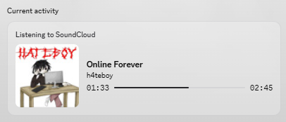

<!-- [TODO: добавить бейдж статуса сборки: в архиве исходников не найдены ни CI-workflow, ни URL репозитория] -->

[English](README.md) | **Русский**



# rpc4SoundCloud Enhanced

Discord Rich Presence для SoundCloud. Проект считывает текущий трек из вкладки браузера на soundcloud.com и публикует его как активность "Listening to SoundCloud" в десктопном клиенте Discord через плагин Vencord.

Это форк [rpc4SoundCloud](https://github.com/loren-wastaken/rpc4SoundCloud) авторства loren-wastaken. Обработка состояния воспроизведения переписана; см. [Улучшения по сравнению с оригиналом](#улучшения-по-сравнению-с-оригиналом).

## Содержание

- [Улучшения по сравнению с оригиналом](#улучшения-по-сравнению-с-оригиналом)
- [Архитектура](#архитектура)
- [Требования](#требования)
- [Установка](#установка)
- [Конфигурация](#конфигурация)
- [Проверка](#проверка)
- [Справочник по поведению](#справочник-по-поведению)
- [Известные проблемы](#известные-проблемы)
- [Структура проекта](#структура-проекта)
- [Лицензия](#лицензия)
- [Отказ от ответственности](#отказ-от-ответственности)

## Улучшения по сравнению с оригиналом

| Область | Поведение в оригинале | rpc4SoundCloud Enhanced |
|---|---|---|
| Таймер при паузе | Таймер продолжал идти, пока трек стоял на паузе | При паузе presence очищается. При возобновлении таймер пересчитывается по текущей позиции воспроизведения |
| Индикатор прогресса | Не отображался; передавалось только прошедшее время (`timestamps.start`) | Длительность трека считывается из плеера (`durationSeconds`) и передаётся как `timestamps.end`, что включает отображение индикатора прогресса |
| Буферизация | Не обрабатывалась | Буферизация определяется (позиция равна 0 или не меняется в нескольких последовательных опросах). Presence скрывается до продолжения воспроизведения |
| Перезагрузка страницы | После перезагрузки страницы SoundCloud мог сохраняться устаревший presence | Presence очищается при подключении расширения к relay-серверу и при каждой смене URL |
| Одиночные треки | Название отображалось дважды на всех треках из-за поля `large_text` (подсказка обложки), которое Discord дублировал во вторую строку | Строка с исполнителем опускается, если она совпадает с названием (без учёта регистра). Поле `large_text` удалено, чтобы избежать дублирования |
| Распространение | Только ручная установка | Опубликовано в Firefox Add-ons |

## Архитектура

Система состоит из трёх компонентов, связанных через локальный WebSocket-relay.

| Компонент | Каталог | Где выполняется | Назначение |
|---|---|---|---|
| Расширение для браузера | `extension/` | Браузер, на вкладках `soundcloud.com` | Раз в секунду опрашивает `navigator.mediaSession` и временную шкалу плеера. При изменении данных отправляет JSON-payload на relay-сервер |
| Relay-сервер | `relay-server/` | Процесс Node.js на локальной машине | WebSocket-сервер. Пересылает каждое полученное сообщение всем остальным подключённым клиентам |
| Плагин Vencord | `vencord-plugin/` | Десктопный клиент Discord с Vencord | Подключается к relay-серверу, преобразует payload в активность и отправляет `LOCAL_ACTIVITY_UPDATE` |

Поток данных:

```text
SoundCloud tab -> extension (WS client) -> relay server (WS server) -> Vencord plugin (WS client) -> Discord
```

Relay-сервер необходим, поскольку ни вкладка браузера, ни рендерер-процесс Discord не могут принимать входящие соединения.

## Требования

| Зависимость | Где используется | Примечания |
|---|---|---|
| Node.js и npm | Relay-сервер | Требуемая версия в исходниках не указана |
| `ws` `^8.18.0` | Relay-сервер | Устанавливается командой `npm install` |
| Клон исходного кода Vencord | Плагин Vencord | Плагин собирается в составе Vencord из исходников (`src/userplugins/`) |
| pnpm | Сборка Vencord | `linux.sh` устанавливает его через npm, если он отсутствует |
| git | Клонирование Vencord | Требуется для `linux.sh` |
| Десктопный клиент Discord | Отображение presence | Vencord должен быть внедрён в клиент |
| Firefox, Chrome, Edge или Opera | Расширение | См. [Расширение для браузера](#2-расширение-для-браузера) |

## Установка

Необходимо установить все три компонента. Relay-сервер и плагин Vencord не распространяются через магазины расширений браузеров.

### 1. Relay-сервер

```bash
cd relay-server
npm install
npm start
```

Процесс должен оставаться запущенным, пока используется presence. Сервер слушает порт `6989`.

#### Автозапуск в Windows

1. Выполните `npm install` в каталоге `relay-server/` как минимум один раз.
2. Нажмите `Win + R`, введите `shell:startup` и нажмите Enter.
3. Создайте в папке автозагрузки ярлык, указывающий на `relay-server/start-relay.vbs`.

Скрипт запускает `npm start` без окна консоли. Если процесс аварийно завершится, ошибка не отобразится. Чтобы убедиться, что процесс работает, проверьте наличие процесса `node.exe` в диспетчере задач.

#### Linux

`linux.sh` автоматизирует установку зависимостей relay-сервера и плагина Vencord:

```bash
chmod +x linux.sh
./linux.sh
```

Скрипт выполняет следующие шаги и может запускаться повторно:

1. Проверяет наличие `node` и `git`. Если `pnpm` отсутствует, устанавливает его через npm.
2. Выполняет `npm install` в каталоге `relay-server/`.
3. Клонирует Vencord в `~/Vencord`, если этот каталог не существует, затем выполняет `pnpm install`.
4. Копирует `vencord-plugin/index.tsx` в `~/Vencord/src/userplugins/rpc4SoundCloud/index.tsx`.
5. Выполняет `pnpm build` в `~/Vencord`.
6. Опционально выполняет `pnpm inject` (интерактивный запрос).
7. Опционально создаёт и включает пользовательский unit systemd `rpc4soundcloud-relay.service`.

Состояние unit-а systemd можно проверить командой:

```bash
systemctl --user status rpc4soundcloud-relay.service
```

Скрипт не устанавливает расширение для браузера; следуйте инструкциям из следующего раздела.

### 2. Расширение для браузера

#### Firefox

Установите со страницы в официальном каталоге Firefox Add-ons:

https://addons.mozilla.org/ru/firefox/addon/rpc4soundcloud-enhanced/

#### Chrome, Edge, Opera

Расширение не опубликовано в Chrome Web Store. Установите его как распакованное расширение:

1. Скачайте этот репозиторий в виде ZIP-архива и распакуйте его.
2. Откройте страницу расширений:

   | Браузер | URL |
   |---|---|
   | Chrome | `chrome://extensions/` |
   | Edge | `edge://extensions/` |
   | Opera | `opera://extensions/` |

3. Включите режим разработчика.
4. Нажмите "Загрузить распакованное расширение".
5. Выберите папку `extension` из распакованного архива.

Распакованная папка должна оставаться на месте: браузер загружает расширение из неё.

### 3. Плагин Vencord

В Linux шаги 1 и 2 ниже выполняет `linux.sh`. В других системах выполните все шаги вручную.

1. Скопируйте каталог `vencord-plugin/` в `src/userplugins/rpc4SoundCloud/` внутри локального дерева исходников Vencord.
2. Пересоберите Vencord и перезапустите Discord:

   ```bash
   pnpm build
   pnpm inject
   ```

3. Включите плагин `rpc4SoundCloud` в разделе "Настройки", "Vencord", "Плагины".
4. В Discord включите "Настройки", "Конфиденциальность активности", "Показывать текущую активность в статусе".
5. Опционально, необходимо для обложки: задайте параметр плагина `appId`. См. [Конфигурация](#конфигурация).

Файл `vencord-plugin/index.tsx` в этом репозитории является справочной копией. Во время работы используется файл из дерева исходников Vencord. После редактирования плагина обновите обе копии и пересоберите Vencord.

## Конфигурация

### Настройки плагина

Находятся в разделе "Настройки", "Vencord", "Плагины", rpc4SoundCloud.

| Параметр | Тип | По умолчанию | Описание |
|---|---|---|---|
| `relayPort` | number | `6989` | Порт relay-сервера, к которому подключается плагин (`ws://127.0.0.1:<port>`) |
| `appId` | string | пусто | Application ID приложения Discord. Необходим для обложки. Если не задан, обложка не отправляется |

### Обложка

Discord не принимает прямой URL изображения в `assets.large_image`. Плагин преобразует URL обложки в идентификатор ассета через `ApplicationAssetUtils.fetchAssetIds`, для чего требуется зарегистрированное приложение Discord.

1. Откройте [Discord Developer Portal](https://discord.com/developers/applications) и создайте новое приложение.
2. Скопируйте Application ID со страницы General Information.
3. Вставьте его в параметр плагина `appId`.

### Порт relay

Помимо параметра плагина, порт жёстко задан ещё в двух местах. Для его изменения необходимо отредактировать все три.

| Файл | Расположение |
|---|---|
| `relay-server/server.js` | `const PORT = 6989;` |
| `extension/content.js` | `const RELAY_URL = "ws://localhost:6989";` |
| Настройки плагина | `relayPort` |

## Проверка

1. Запустите relay-сервер. В консоли будет выведено `[relay] rpc4SoundCloud relay listening on ws://localhost:6989`.
2. Откройте вкладку soundcloud.com и запустите воспроизведение.
3. В консоли разработчика страницы убедитесь в наличии сообщения `[rpc4SoundCloud] connected to relay`.
4. Убедитесь, что активность отображается в профиле Discord.

## Справочник по поведению

### WebSocket-интерфейс relay

| Свойство | Значение |
|---|---|
| Протокол | WebSocket (текстовые фреймы) |
| Адрес | `ws://localhost:6989` |
| Поведение | Каждое сообщение пересылается без изменений всем остальным подключённым клиентам |
| Тело сообщения | JSON: объект payload либо `null` для очистки presence |

### Поля payload

Отправляются расширением, обрабатываются плагином.

| Поле | Тип | Источник |
|---|---|---|
| `title` | string или null | `navigator.mediaSession.metadata.title` |
| `artist` | string или null | `navigator.mediaSession.metadata.artist` |
| `artworkUrl` | string или null | Последний элемент `metadata.artwork` |
| `playing` | boolean | `navigator.mediaSession.playbackState === "playing"` |
| `buffering` | boolean | Вычисляется; см. ниже |
| `positionSeconds` | number или null | `aria-valuenow` элемента `.playbackTimeline__progressWrapper` |
| `durationSeconds` | number или null | `aria-valuemax` элемента `.playbackTimeline__progressWrapper` |
| `url` | string | `location.href` |

### Обработка состояний

| Условие | Расширение | Плагин |
|---|---|---|
| Воспроизведение | Отправляет payload, если он отличается от предыдущего (опрос каждые 1000 мс) | Формирует активность. `timestamps.start = now - positionSeconds`; `timestamps.end = start + durationSeconds`, если длительность больше позиции |
| Переход из воспроизведения в паузу | Отправляет `null` | Очищает активность |
| Пауза (получен payload с `playing: false`) | Payload отправляется | Активность не формируется; presence очищается |
| Буферизация: `positionSeconds === 0` или позиция не меняется в 2 и более последовательных опросах | Отправляет payload с `buffering: true` | Активность не формируется; presence очищается |
| Смена URL | Отправляет `null` | Очищает активность |
| Расширение подключается к relay-серверу | Отправляет `null` | Очищает активность |
| Соединение с relay закрыто | Переподключается с экспоненциальной задержкой от 1 с до 30 с | Очищает активность, переподключается каждые 3 с |
| Исполнитель совпадает с названием (без учёта регистра) | Не применимо | `state` опускается; задаётся только `details` |

## Известные проблемы

| Проблема | Причина | Статус |
|---|---|---|
| Кнопки в статусе не работают | Ограничение Vencord (механизм `LOCAL_ACTIVITY_UPDATE` не передает `metadata.button_urls`) | Не решено |
| Presence не очищается при закрытии вкладки с воспроизводимым треком | Расширение не отправляет сообщение при закрытии вкладки, а relay не уведомляет остальных клиентов об отключении | Не решено |
| Несколько открытых вкладок SoundCloud перезаписывают presence друг друга | Сообщения не помечаются идентификатором вкладки; relay пересылает все сообщения | Не решено |
| Обложка не отображается | В настройках плагина не задан `appId` | См. [Обложка](#обложка) |
| Presence скрыт на позиции трека 0 | Позиция 0 рассматривается как буферизация | Так задумано |

## Структура проекта

| Путь | Описание |
|---|---|
| `extension/content.js` | Content-скрипт: считывает состояние воспроизведения и отправляет его на relay-сервер |
| `extension/manifest.json` | Manifest V3; host-разрешение и совпадение для content-скрипта: `*://soundcloud.com/*` |
| `relay-server/server.js` | WebSocket-relay |
| `relay-server/start-relay.vbs` | Скрипт Windows, запускающий relay-сервер без окна консоли |
| `vencord-plugin/index.tsx` | Плагин Vencord (справочная копия) |
| `linux.sh` | Установщик для Linux: зависимости relay-сервера и плагин |

## Лицензия

MIT. См. [LICENSE](./LICENSE).

## Отказ от ответственности

Vencord является модификацией клиента Discord и не разрешён условиями использования Discord. Используйте на свой риск.

## Благодарности

Этот проект является форком [rpc4SoundCloud](https://github.com/loren-wastaken/rpc4SoundCloud) авторства [loren-wastaken](https://github.com/loren-wastaken). Оригинальная архитектура и базовый код были созданы им под лицензией MIT. В этом форке была переписана обработка состояния воспроизведения, синхронизация таймера и реализация индикатора прогресса.

<br>


